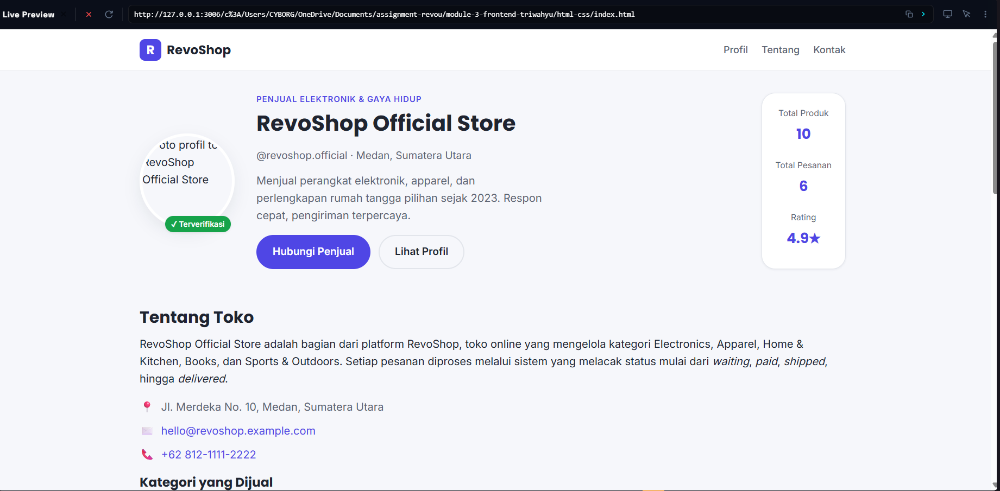
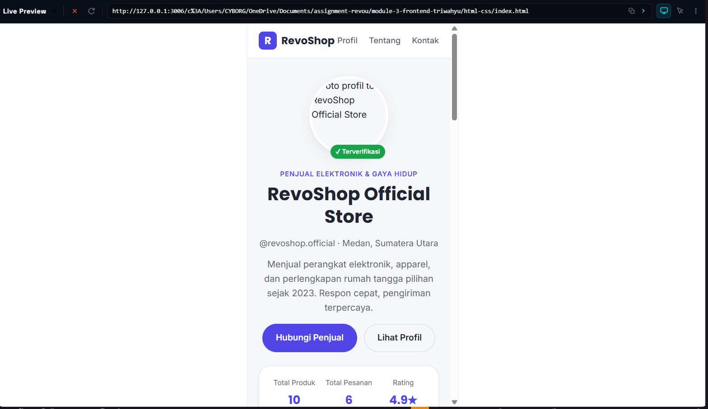
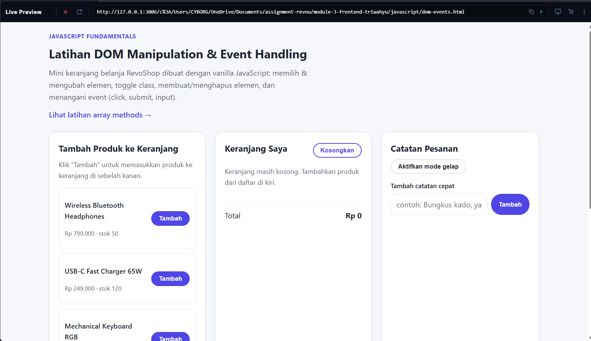
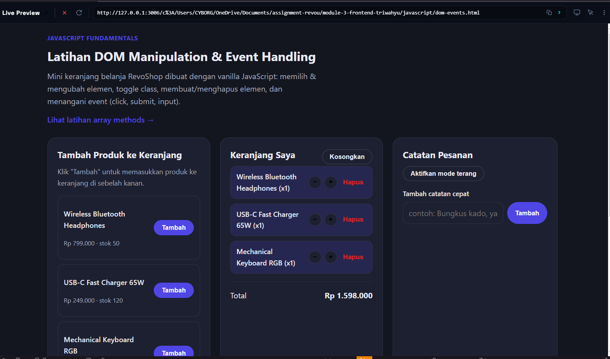
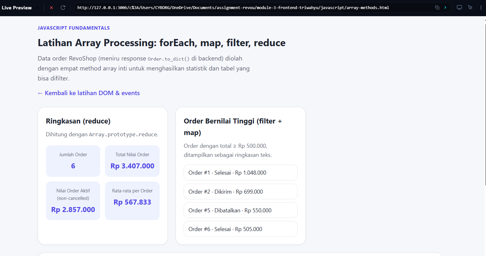
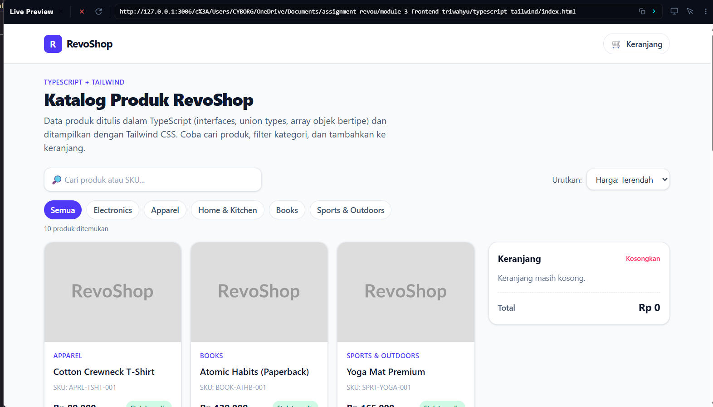
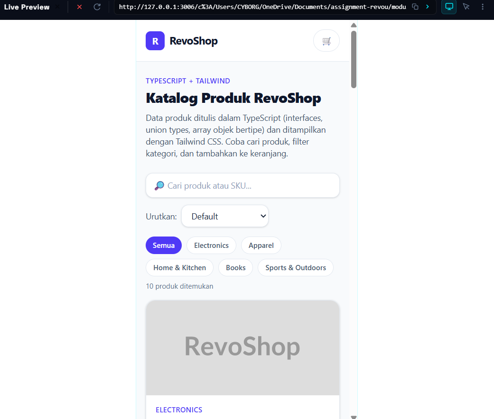

# RevoShop — Frontend Fundamentals (Checkpoint 1)

Latihan fundamental sebelum masuk ke Next.js/React di Checkpoint 2: HTML
semantik, CSS Grid/Flexbox + responsive, vanilla JavaScript (DOM & array
methods), dan TypeScript + Tailwind CSS. Semua data contoh (produk,
kategori, order) sengaja dibuat menyerupai bentuk response API backend
RevoShop (`backend/app/models/*.py`, lihat `backend/README.md`), supaya
latihan ini terasa seperti pemanasan langsung untuk RevoShop yang
sesungguhnya.

## Struktur Folder

```
html-css/            -> Halaman profil semantik + form kontak (HTML5 + CSS Grid/Flexbox, responsive)
javascript/           -> Latihan DOM manipulation/events & array methods (forEach/map/filter/reduce)
typescript-tailwind/  -> Proyek TypeScript + Tailwind CSS: katalog produk bertipe, live search, keranjang interaktif
backend/               -> Flask + PostgreSQL API RevoShop (checkpoint sebelumnya, tidak diubah di checkpoint ini)
```

### `html-css/`

Halaman profil toko RevoShop (`index.html` + `styles.css`), dibangun
dengan elemen HTML5 semantik (`header`, `main`, `section`, `footer`),
form kontak dengan label & tipe input yang sesuai (email, tel, select,
radio, checkbox), layout `profile-hero` dengan CSS Grid dua kolom di
layar besar, dan breakpoint responsive di `640px` (tablet) &
`900px` (desktop).

**Cara menjalankan:** buka `html-css/index.html` langsung di browser
(double-click, atau klik kanan → "Open with Live Server" jika memakai
ekstensi VS Code/Kiro).

### `javascript/`

Dua halaman latihan vanilla JS yang saling terhubung lewat link
navigasi:

- `dom-events.html` + `dom-events.js` — mini keranjang belanja RevoShop:
  memilih/mengubah elemen DOM, toggle class (dark mode, tandai catatan
  selesai), membuat & menghapus elemen (catatan, item keranjang), serta
  event handling (`click`, `submit` dengan `preventDefault()`).
- `array-methods.html` + `array-methods.js` — mengolah data order
  RevoShop dengan `forEach`, `map`, `filter`, dan `reduce` untuk
  menghasilkan statistik, daftar order bernilai tinggi, dan tabel yang
  bisa difilter per status.

Kedua halaman berbagi `shared.css`.

**Cara menjalankan:** buka `javascript/dom-events.html` atau
`javascript/array-methods.html` langsung di browser. Tidak butuh build
step — file `.js` di-load langsung lewat tag `<script>`.

### `typescript-tailwind/`

Katalog produk RevoShop yang ditulis dalam TypeScript dan distyling
sepenuhnya dengan Tailwind CSS (utility-first, tanpa CSS custom).

- `src/types.ts` — `interface Product`, `interface Category`, union
  types (`StockStatus`, `CatalogNotification` sebagai discriminated
  union, `SortOption`).
- `src/data.ts` — array produk & kategori bertipe, disalin dari
  `backend/1_checkpoint_revoshop_sql/seed.sql`.
- `src/catalog.ts` — logika murni (filter, sort, operasi keranjang)
  yang reusable & tidak bergantung pada DOM.
- `src/render.ts` — fungsi render DOM (product card, grid, filter
  kategori, keranjang, toast notifikasi), memetakan field bertipe
  (`StockStatus`) ke class Tailwind kondisional.
- `src/main.ts` — entry point yang menyatukan state, event listener
  (live search, filter kategori, sort, tambah/kurang/hapus item
  keranjang).
- `index.html` — layout mobile-first (grid 1 kolom di HP, `sm:` 2
  kolom, `lg:` grid produk + panel keranjang sticky di sebelah kanan).

**Cara menjalankan (butuh Node.js ≥ 18):**

```powershell
cd typescript-tailwind
npm install
npm run build      # menjalankan tsc lalu tailwindcss CLI
```

Setelah build selesai, buka `typescript-tailwind/index.html` langsung
di browser (atau lewat Live Server). Untuk mode watch saat development:

```powershell
npm run watch:ts    # terminal 1
npm run watch:css   # terminal 2
```

`tsc` dikonfigurasi lewat `tsconfig.json` (strict mode aktif —
`strict`, `noImplicitAny`, `noUnusedLocals`, dst). Tailwind CSS 4
dijalankan lewat `@tailwindcss/cli`, mengambil `styles/input.css`
(`@import "tailwindcss";`) dan otomatis memindai class yang dipakai di
`index.html` serta `dist/*.js` hasil kompilasi TypeScript.

### `backend/`

Backend Flask + PostgreSQL dari checkpoint sebelumnya (lihat
`backend/README.md` untuk detail lengkap). Tidak disentuh pada
checkpoint frontend fundamentals ini — hanya dijadikan referensi bentuk
data (`Product`, `Category`, `Order`) untuk ketiga folder di atas.

## Commit History

Riwayat commit disusun bertahap per topik: HTML/CSS, lalu JavaScript
(DOM/events dan array methods), lalu TypeScript + Tailwind — sesuai
urutan pengerjaan checkpoint ini.

## Screenshot

Screenshot disimpan di folder [`screenshots/`](screenshots/) — lihat
`screenshots/README.md` untuk daftar nama file yang diharapkan dan cara
mengambilnya. Setelah file-file itu ada, tampilkan di sini:

1. `html-css/index.html` pada lebar desktop (≥ 1024px):
   
2. `html-css/index.html` pada lebar mobile (≤ 480px):
   
3. `javascript/dom-events.html` — mini keranjang belanja:
   
   
4. `javascript/array-methods.html` — statistik & tabel order:
   
5. `typescript-tailwind/index.html` dengan live search aktif (desktop):
   
6. `typescript-tailwind/index.html` pada lebar mobile:
   

> Catatan: gambar di atas hanya akan muncul setelah file screenshot
> benar-benar ada di folder `screenshots/` dengan nama yang sesuai.
